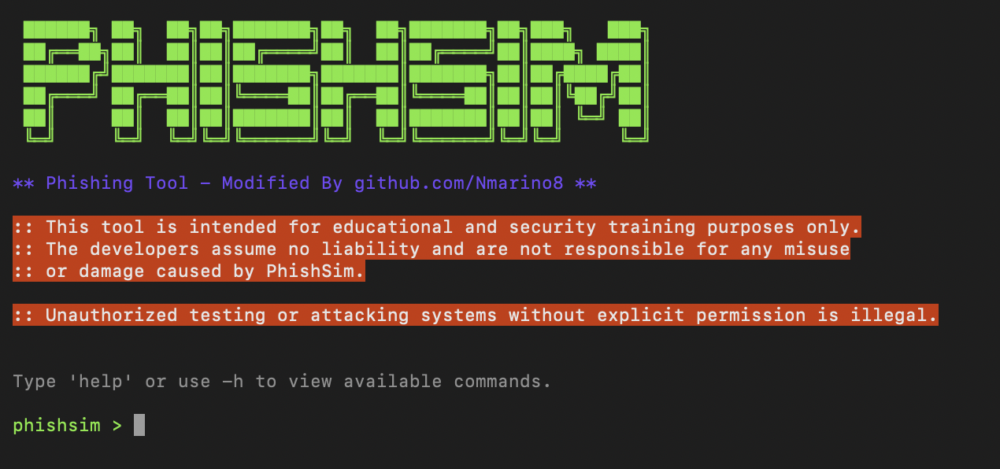
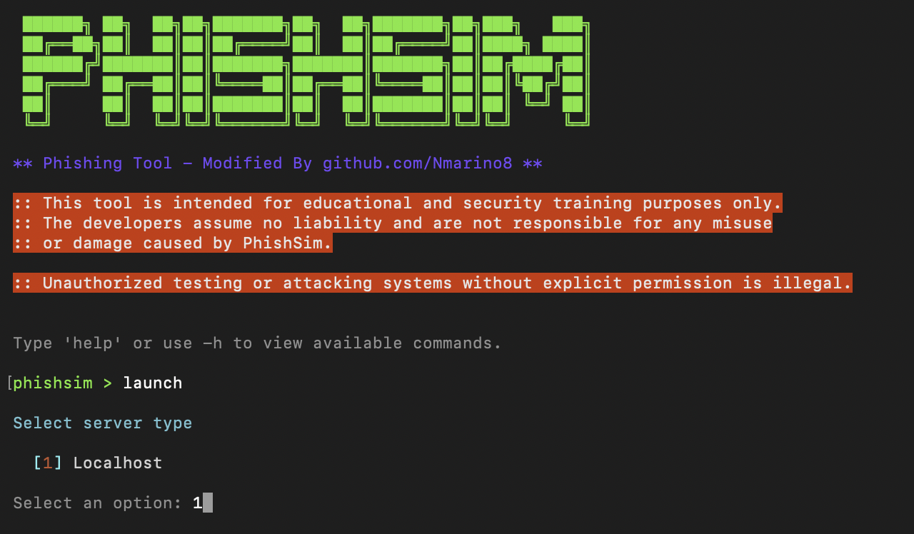
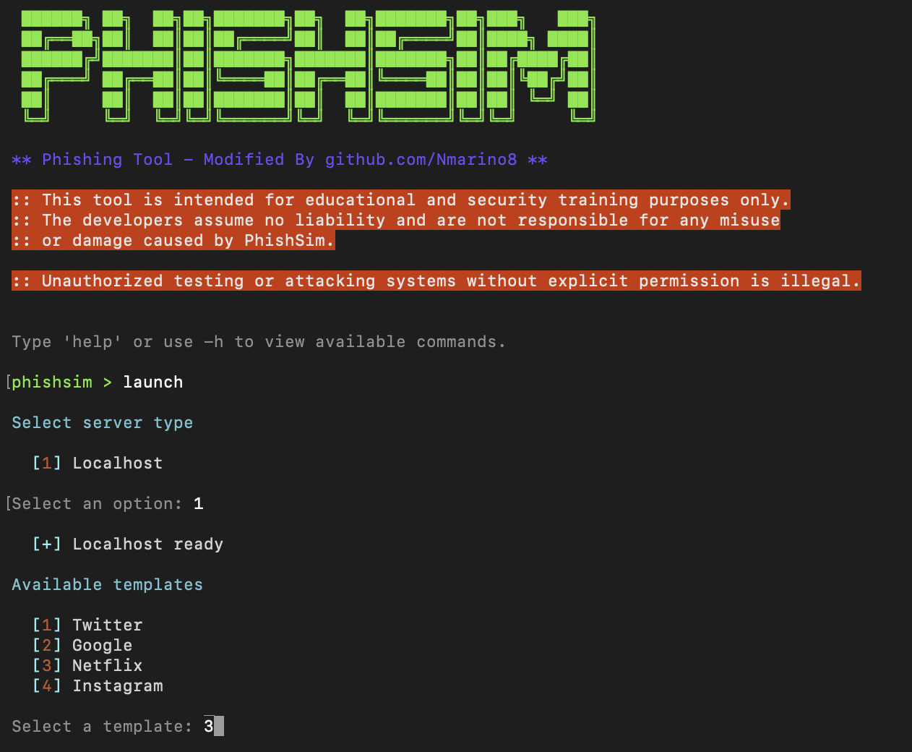

<h1 align="center">
  
  <br />
  PhishSim
</h1>

<p align="center">
  An educational phishing-simulation tool — learn how phishing attacks work in a safe, controlled, local environment.
</p>

---

## What is PhishSim?

**PhishSim helps cybersecurity students and trainers understand phishing attacks hands-on:**

- Hosts local awareness-training pages inspired by common sign-in patterns
- Reports only that a demo form was submitted; entered values are never sent to or displayed by the server
- Extensible template system — add new simulation pages without touching the server core
- Cross-platform support on Windows, macOS, and Linux
- Simple terminal-based interface for full server control

**`PhishSim does not collect, store, or transmit submitted form values.`**

> [!WARNING]
> PhishSim is strictly for **educational purposes and security awareness training**.
> Never deploy phishing templates on public networks or use this tool maliciously.
> The author is not responsible for misuse.

---

## How It Works

A complete walkthrough of PhishSim running in a controlled local environment:

**1. Start the Application**

<p align="center">
  
</p>

**2. Choose Server Type**

<p align="center">
  
</p>

**3. Select a Template**

<p align="center">
  
</p>

**4. Template Opens in Browser**

<p align="center">
  
</p>

After submitting the form, PhishSim reports only the training event. The entered values are discarded by the page and are not sent to the server.

---

## Installation

### Requirements

- .NET SDK installed ([verify with `dotnet --version`](https://dotnet.microsoft.com/en-us/download))
- .NET 10 SDK or newer
- Windows, macOS, or Linux

### Steps

Clone the repository and navigate into the project:
```bash
git clone https://github.com/Nmarino8/PhishSim.git
cd PhishSim/PhishSim
```

Build the project:
```bash
dotnet build
```

---

## Usage

Run the project:
```bash
dotnet run
```

Or from a parent folder:
```bash
dotnet run --project PhishSim/PhishSim.csproj
```

Then follow the prompts:

1. Use `launch` to start the interactive template picker
2. Or launch a template directly with `launch Google`
3. Use `list` to view all templates available in the current build
4. Select the server type — currently **Localhost** only
5. The local server starts and opens your default browser with the chosen template
6. Interact with the page — enter any username and password
7. Watch the terminal — a submission event is displayed, without any form values

---

## Features

- **Awareness Simulations** — serves local training pages inspired by common sign-in patterns
- **Privacy by design** — submitted values are not read by the scripts or accepted by the server; only a fixed submission event is reported
- **Local-only server** — binds to `127.0.0.1`, restricts file requests to the selected template, and rejects unsupported HTTP methods
- **Request limits** — caps the training-event request body and validates the expected event
- **Extensible Templates** — add new templates by dropping a folder into `Templates/` — no core changes needed
- **Cross-platform** — runs on Windows, macOS, and Linux via .NET
- **Terminal Interface** — clean CLI for server control, template selection, and output

---

## Built-in Templates

| Template | Mimics |
|---|---|
| **Google** | Google login page |
| **Instagram** | Instagram login page |
| **Netflix** | Netflix login page |
| **Twitter** | Twitter login page |

You can add your own training templates — see below.

---

## Adding Custom Templates

1. Create a new folder inside `Templates/` — the folder name becomes the template name in PhishSim.

2. Add the following files inside your new folder:

   | File | Required | Purpose |
   |---|---|---|
   | `index.html` | ✅ | Main HTML page for the template |
   | `script.js` | ✅ | Reports a submission event without reading or sending form values |
   | `styles.css` | Optional | CSS styling for the page |
   | `images/` | Optional | Images and asset files |

3. Your `index.html` **must** include a form with these exact IDs:
   - `id="loginForm"` on the `<form>` element
   - `id="username"` on the username input
   - `id="password"` on the password input

4. Add this safe, event-only handler to your `script.js`:
```javascript
const form = document.getElementById('loginForm');

form.addEventListener('submit', (e) => {
    e.preventDefault();

    fetch('/demo', {
        method: 'POST',
        headers: { 'Content-Type': 'application/json' },
        body: JSON.stringify({ event: 'form-submitted' })
    }).then((response) => {
        if (!response.ok) {
            throw new Error('Simulation endpoint returned an error');
        }
    }).catch(() => {
        window.alert('The local simulation could not be reached. No information was collected.');
    }).finally(() => form.reset());
});
```

Do not read, submit, log, or store the form fields. The built-in templates follow this rule; the server accepts only the fixed training event and does not display submitted values.

5. Restart PhishSim — the new template appears automatically in the selection menu.

> [!TIP]
> The server auto-detects new templates on startup. No changes to the core code are ever needed.

---

## Project Structure
```bash
PhishSim/
├── CLI/                        # Command-line interface
│   ├── CommandRouter.cs
│   ├── ConsoleUI.cs
│   └── Commands/
│       ├── LaunchCommand.cs
│       └── ListCommand.cs
├── Server/                     # Local server logic and template serving
│   ├── LocalServers.cs
│   ├── RequestFilter.cs
│   └── ServerConfig.cs
├── Templates/                  # Simulation website templates
│   ├── Google/
│   ├── Instagram/
│   ├── Netflix/
│   └── Twitter/
│   ├── Instagram/
│   ├── Netflix/
│   └── Twitter/
├── Utils/                      # Helper utilities
│   └── TerminalAnimation.cs
├── PhishSim.csproj             # .NET project file
└── Program.cs                  # Main entry point
```

---

## Data & Privacy

PhishSim binds its HTTP server to the loopback interface (`127.0.0.1`). The built-in templates never read or transmit the values entered into their fields; they send only a fixed `form-submitted` event. The server validates that event, reports it in the terminal, and does not log or persist form values. Use fictional data for demonstrations, and review custom templates before running them.

> [!NOTE]
> PhishSim is inspired by **BlackEye** as a foundation for educational phishing simulations.
> Thanks to the cybersecurity community for guidance, insights, and best practices.

> [!WARNING]
> This tool is intended for **learning, training, and security awareness only**.
> Always use PhishSim responsibly. The author is not responsible for any misuse.

---

<h3 align="center">
  PhishSim welcomes contributions — new templates, server improvements, bug fixes, and CLI enhancements.<br />
  Fork the repo, make your changes, and open a Pull Request. Use Issues for bugs, features, and questions.
</h3>

---

<p align="center">
  © 2026 Niko Marinović. All rights reserved.
</p>
